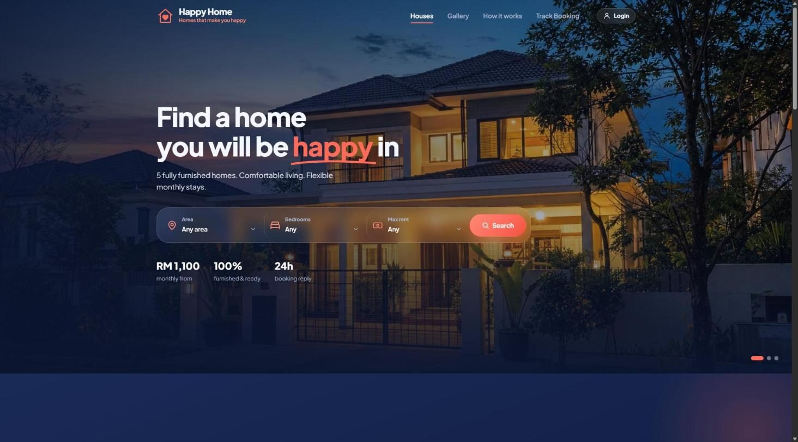
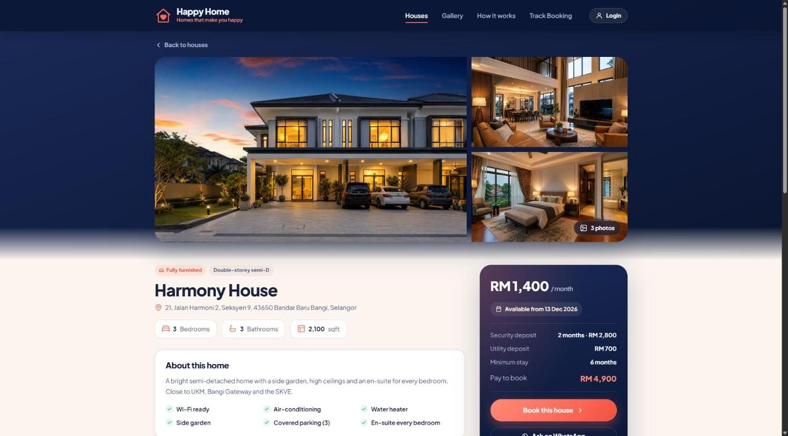
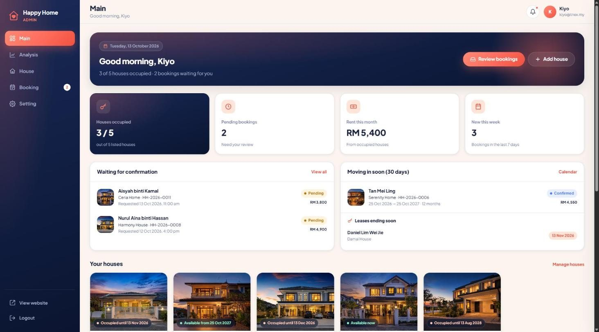
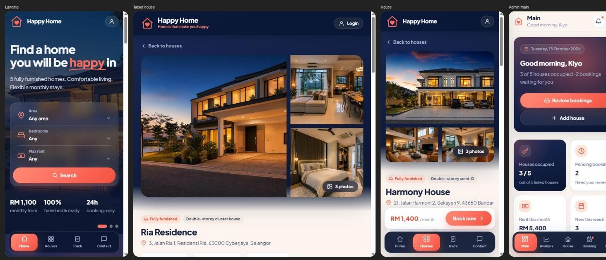

# Happy Home

Software Version: 1.0.0

## Description
A rental website for five fully furnished houses let by the month. Customers browse the houses, open any house to see every room and what is inside it, book a move-in date by uploading a bank-transfer receipt, and check their booking later using only their phone number. The owner signs in to an admin dashboard to confirm or reject bookings, add and edit houses (rooms, items and photos included), follow the numbers, and change company and payment details.

Built with plain HTML, CSS and JavaScript. There is no framework, no build step and no backend: all data lives in the browser's `localStorage`, so the site runs anywhere a browser can open a folder.

## Features

**Website (customers)**
- Hero with crossfading twilight photos and a search by area, bedrooms and maximum rent
- Five house cards with furnishing, monthly rent, bedrooms, bathrooms, size and "Available now / from" badges, plus filter chips
- House page: photo gallery with lightbox, description and amenities, **every room with the items inside it**, booked periods, and a price panel (rent, deposit, utility deposit, minimum stay, amount to pay)
- Booking form: move-in date and number of months, live payment summary, customer details, bank details, receipt upload (image or PDF) and a booking reference on success
- **Track booking by phone number only** (any format: `012-345 6789`, `0123456789`, `+60 12-345 6789`) with a status stepper and the note from Happy Home
- Gallery of every house photo, "How it works", contact footer
- Phone layout with a bottom navigation bar

**Admin dashboard (owner)**
- **Main**: occupancy, pending bookings, rent this month and new bookings at a glance, bookings waiting for confirmation, move-ins in the next 30 days, leases ending soon, every house's status, recent activity
- **Analysis**: rent collected per month, occupancy by house, bookings by status, requests per month and top houses, for 6, 12 or 24 months
- **House**: add, edit, hide or delete houses, with details, pricing, photo upload (reorder, captions, cover), a **room builder** (rooms, items and quantities) and amenities
- **Booking**: filter and search bookings, view the receipt and payment breakdown, confirm, reject or cancel with a note the customer sees when tracking, and message the customer on WhatsApp
- **Setting**: company profile, bank details, booking rules, display name, and demo data reset
- Left sidebar on desktop; bottom navigation on phones

## Screenshots

| Landing page | House page |
|---|---|
|  |  |

| Admin dashboard |
|---|
|  |

| Phone and tablet |
|---|
|  |

## Try it in two minutes

1. Open the website and press **View house** on **Ceria Home** (available now).
2. Scroll to **Rooms & what's inside** and open a few rooms to see their furniture and appliances.
3. Press **Book this house**, keep the suggested move-in date, enter a name and phone number, attach any image as the receipt, tick the box and press **Submit booking**. Note the reference (for example `HH-2026-0015`).
4. Press **Track my booking**: the booking shows as *Pending*.
5. Open **Admin login** (navbar or footer) and sign in with any email and any password. Go to **Booking**, open the new booking, write a note and press **Confirm**.
6. Track the booking again on the website: it now shows *Confirmed* with your note, and the house shows its next free date.
7. In **House**, press **Add house**, add a room with a few items and a photo, and save. The new house appears on the website.

## Running the site

Serve the folder (the admin uses relative paths, so a local server is the most reliable way):

```
python -m http.server 8080
```

Then open:

- Website: http://localhost:8080/
- Admin dashboard: http://localhost:8080/admin/login.html

Port 8080 is fixed. If it is already in use, another copy of the server is probably running - use that one, or stop it with `netstat -ano | findstr :8080` and `taskkill /PID <pid> /F`.

## Demo login

Any email address and any password will sign in, for example `owner@happyhome.my` / `demo`. The name shown in the dashboard comes from the email and can be changed under **Setting > Your account**.

## Demo data and reset

The site creates five houses and 14 sample bookings the first time it opens. Booking dates are placed relative to today, so pending, confirmed, active, ended, rejected and cancelled bookings all appear whenever the demo is opened. A sample customer with several bookings can be tracked with the phone number `012-345 6789`.

To start fresh, use **Setting > Demo data > Reset demo data** in the admin, or run this in the browser console:

```js
localStorage.clear(); location.reload();
```

Uploaded photos and receipts are stored in `localStorage` too, so they stay on the device and browser where they were added. Photos are resized before saving to fit the browser's storage limit.

## Project structure

```
index.html              Website: hero, houses, gallery, how it works, track booking
house.html              House page: photos, rooms and items, price panel, booking form
admin/login.html        Admin sign-in (any email and password)
admin/dashboard.html    Admin dashboard (Main, Analysis, House, Booking, Setting)
css/                    base.css (tokens, animations), components.css, landing.css, house.css,
                        track.css, login.css, admin.css, admin/view-*.css
js/                     ui.js (helpers), seed.js (demo data), store.js (data + booking rules),
                        landing.js, house.js, booking.js, track.js, charts.js
js/admin/               core.js (router, sidebar, drawer) + view-main / view-analysis /
                        view-house / view-booking / view-setting
assets/img/             Hero photos, house photos (assets/img/houses), logo and favicon
docs/screenshots/       Images used in this README
```

## Technology

- HTML5, CSS3 (custom properties, grid, backdrop-filter), vanilla JavaScript (ES2020)
- Chart.js 4.4.1 (CDN) for the Analysis charts
- Google Fonts: Plus Jakarta Sans
- Photos generated with OpenAI gpt-image-2
- GitHub Pages deployment through `.github/workflows/static.yml`
